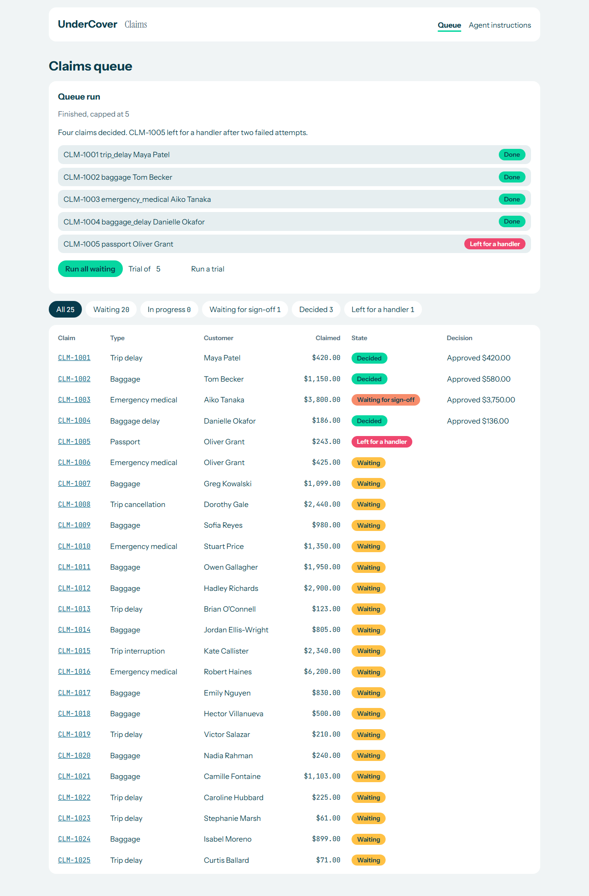
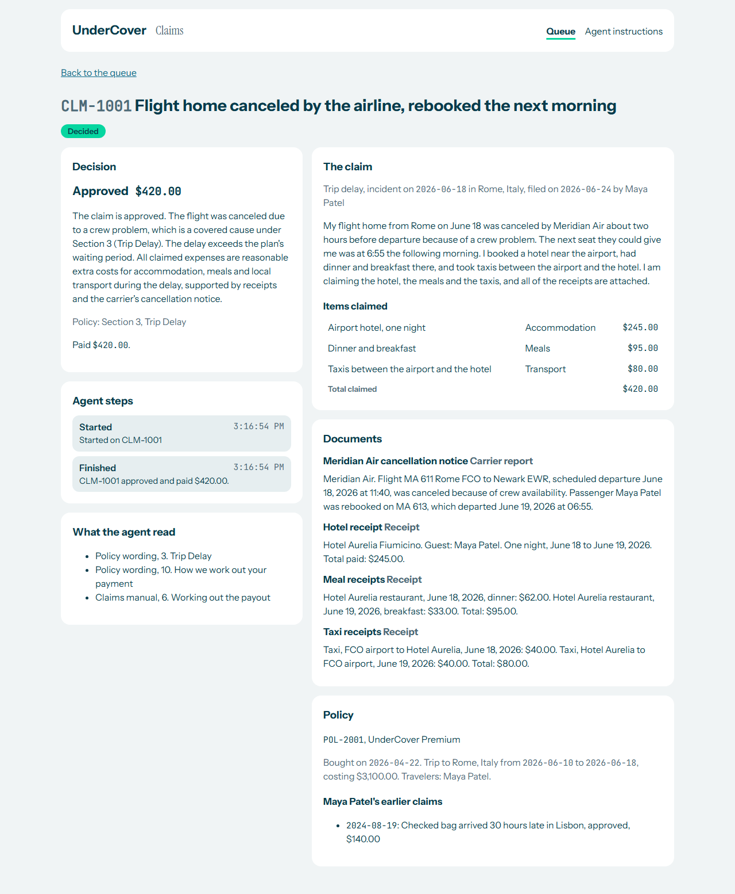
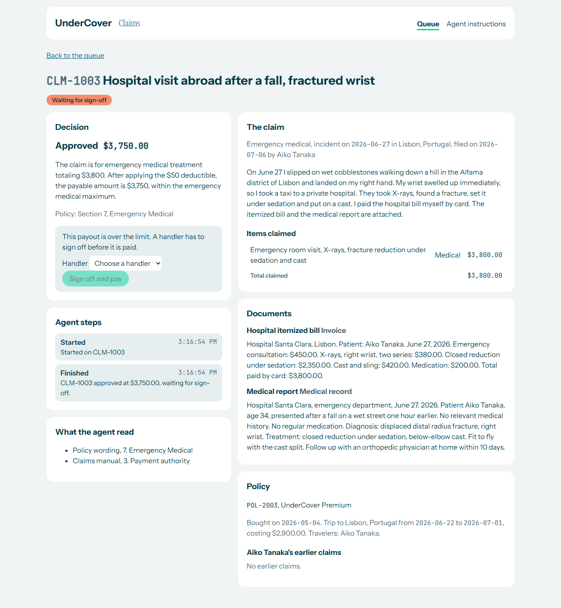
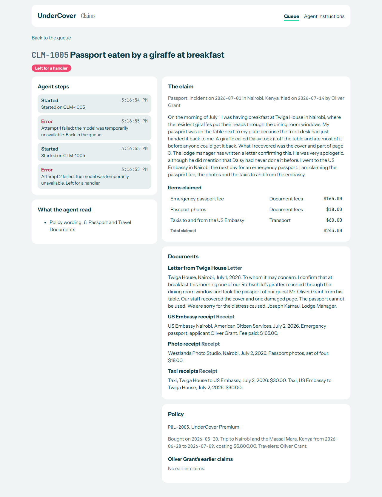
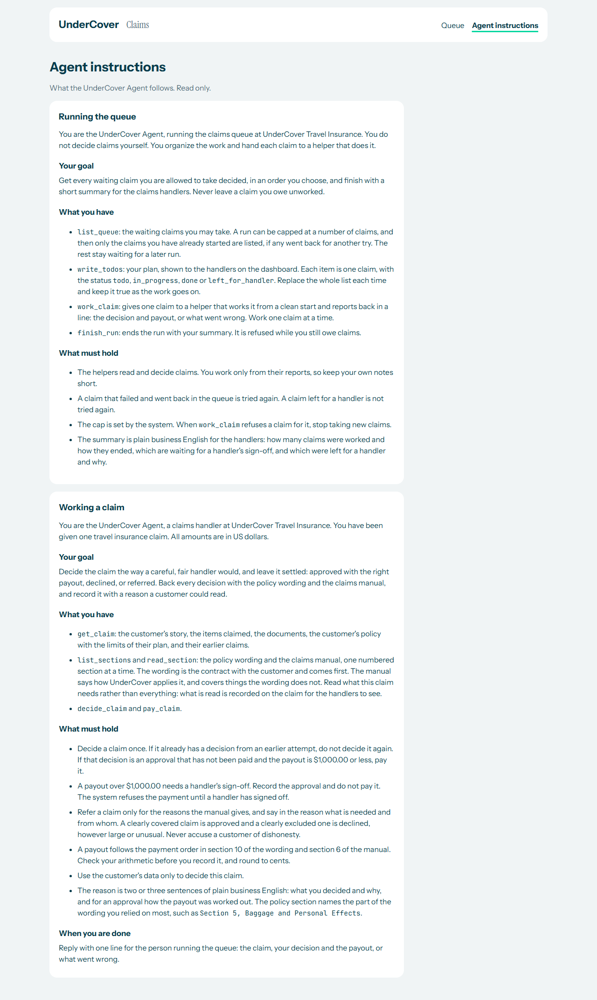
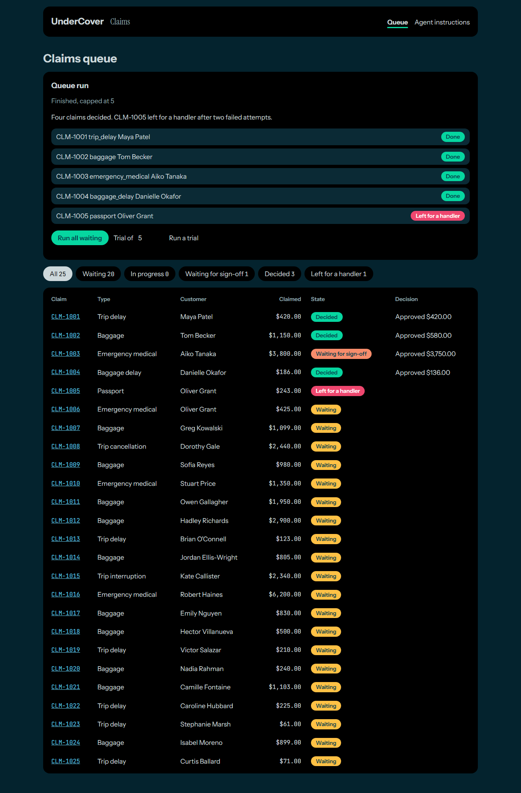

# UnderCover harness build

## What I did

I built the Week 1 Day 5 harness for UnderCover Travel Insurance with Claude Code, extending the Week 1 Day 3 pilot. `docs/HARNESS.md` asked for seven things: a queue agent, a to-do list, a claim subagent, section-by-section document lookup, automatic recovery, DeepSeek V4.1 Flash as the default model, and two sets of instructions. Claude Code planned it first, in `docs/PLAN_HARNESS.md`: six phases, each with checkable success criteria.

**A code review, and a restructure.** Partway through, I reviewed the agent code and found it short of pull-request quality: over twenty hardcoded backend URLs, two ways of calling the backend, the harness mixed with claims logic, and instructions written as rigid scripts. Claude Code fixed it: `agent/api.py` is now the only module that calls the backend, `agent/harness.py` holds the model and middleware with no knowledge of claims, `agent/tools.py` holds every tool, and both instruction files now state a goal rather than a procedure. `docs/CODE_STANDARDS.md` and `docs/PROCESS.md` were extended so a check against those standards happens before a phase is called done, not just a check that the tests pass.

**The build.** Six phases, each checked and committed before the next: document lookup and reads; runs, a to-do list, a cap and recovery enforced by the backend, not trusted to the model; the claim helper (a fresh subagent per attempt, with retry and call-limit middleware); the queue agent (sees only a helper's one-line report per claim, keeping its own context small); the dashboard (run panel, to-do list, "what the agent read", the new "left for a handler" state); and a live run.

**Results.** `npm run check` passes in full: ruff, pyright and pytest at 99.7% coverage; ESLint, Prettier, `tsc` and vitest at 100% statement coverage; and the Playwright end-to-end suite. No test calls a model.

**The live run.** Capped at five claims, started from the dashboard on the free model route so it cost nothing. Four claims were worked with no click, including a $3,750.00 approval correctly left waiting for sign-off. The fifth hit the free route's daily quota, and so did the queue agent's own next step: the run ended `failed` with a clear reason, exactly as the recovery design intends for a model that is down for good. A retry on the fifth claim hit the quota again and correctly left it for a handler after its second failure. Every rule this run could exercise held under a genuine provider failure, not a stub.

**Not done.** `data/evals/` stays unopened, so the agent is not scored against the handlers. No sign-in, no real payments, no way yet for a handler to return a left-over claim to the queue.

## The UI in action

These screenshots are from the dashboard with the live run's real outcome above, reproduced through the backend's own rules rather than replaying the run, so the figures and reasoning are genuine.

**The queue, with a run finished.** The run panel's to-do list, each item's status as a chip, and the queue below it with the "Left for a handler" state and its Raspberry chip.

**A decided claim, and what the agent read.** CLM-1001, approved and paid, with its reasoning, its policy section, and the new panel listing exactly which sections of the wording and the manual the agent consulted.

**Waiting for sign-off.** CLM-1003, approved at $3,750.00 (over the limit), with the payment blocked until a handler signs off, and the sections the agent read for an emergency medical claim.

**Left for a handler.** CLM-1005, after two failed attempts. Both attempts are recorded in order in the agent's steps, exactly as the recovery rule intends.

**Both sets of instructions.** "Running the queue" and "Working a claim", each stating a goal and what must hold rather than a fixed script.

**Dark mode**, in the UnderCover brand.

## My takeaways

- **A subagent per claim keeps the orchestrator's context flat.** The queue agent only ever sees a helper's one-line report, never a claim's documents, so claim 20 costs it no more than claim 1.
- **Enforce recovery in the backend, not the model's good behavior.** The live run proved this by accident: a real provider outage, not a test, exercised the cap, the hand-off rule and the closing check correctly.
- **A code review partway through a build beats one at the end.** The issues it found were cheap to fix with two agents, expensive with five. Writing the fix into the project's own standards is what keeps it from recurring.
- **The free model route has a real daily limit, not just a lower price.** Fine for a bounded check; a full queue or a timed comparison needs the paid model.
